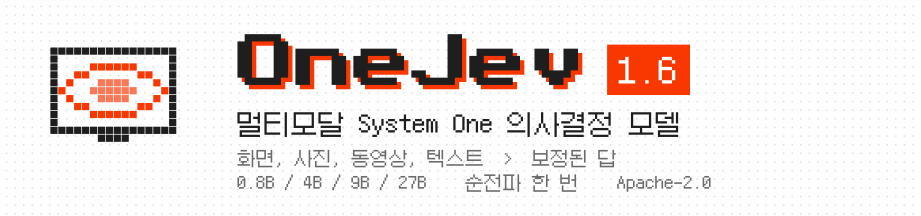
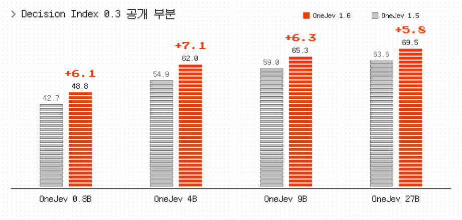
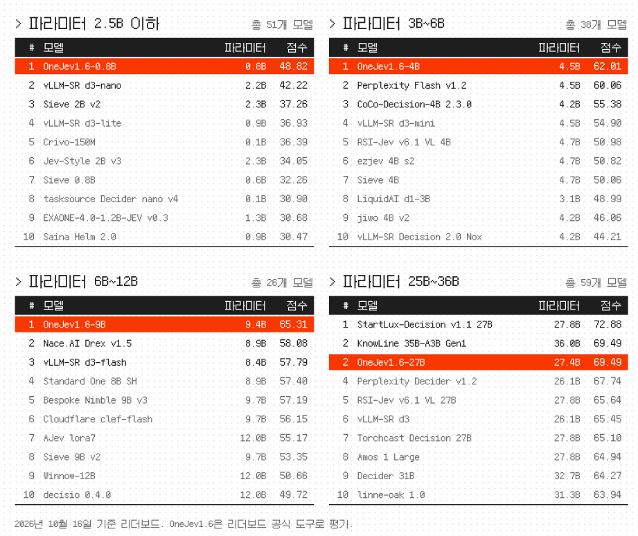
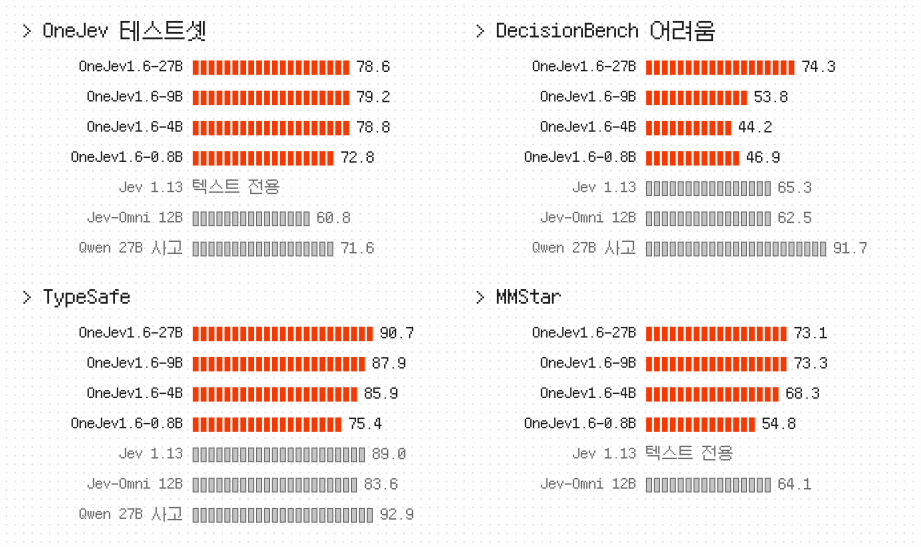
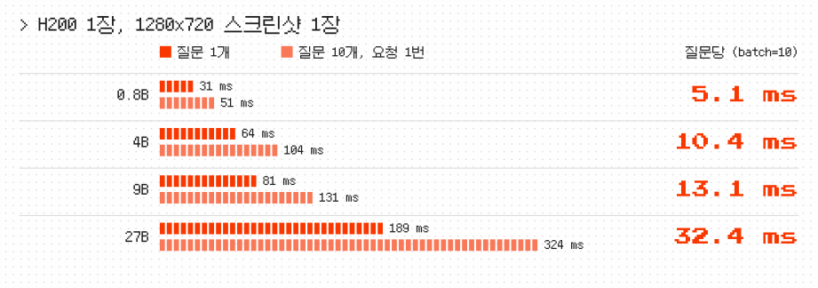

<p align="center">
  <picture>
    <source media="(prefers-color-scheme: dark)" srcset="ko/banner-dark.svg">
    
  </picture>
</p>

<p align="center"><a href="https://github.com/OmniJev/OneJev">English</a> · <a href="README_zh.md">简体中文</a> · <a href="README_zh-Hant.md">繁體中文</a> · <a href="README_ja.md">日本語</a> · <b>한국어</b> · <a href="README_th.md">ภาษาไทย</a> · <a href="README_tr.md">Türkçe</a></p>

<p align="center">
  <a href="https://huggingface.co/collections/OmniJev/onejev16"></a>
  <a href="https://modelscope.ai/organization/OmniJev"></a>
  <a href="https://huggingface.co/spaces/BradNLP/OneJev"></a>
  <a href="https://github.com/OmniJev/OneJev"></a>
  <a href="https://omnijev.github.io/OneJev/"></a>
</p>
<p align="center">
  <a href="https://huggingface.co/datasets/OmniJev/OneJev-Data"></a>
  <a href="../LICENSE"></a>
  <a href="https://github.com/OmniJev/Flide"></a>
  <a href="https://pytorch.org"></a>
  <a href="https://github.com/huggingface/transformers"></a>
</p>

OneJev는 [Qwen](https://huggingface.co/Qwen) 기반의 멀티모달 System One 의사결정 모델입니다. 스크린샷, 사진, 동영상, 텍스트에 대한 타입이 지정된 질문에 순전파 한 번으로 보정된 확률을 돌려줍니다. 0.8B, 4B, 9B, 27B 네 가지 크기로 제공됩니다.

## 🔥 소식

- 🔥 **2026-10-17** [Hugging Face](https://huggingface.co/collections/OmniJev/onejev16)와 [ModelScope](https://modelscope.ai/organization/OmniJev)에 OneJev 1.6을 공개했습니다. 사용해 보세요.
- **2026-10-13** [OneJev 1.5](https://huggingface.co/collections/OmniJev/onejev15)를 공개했습니다. 사용해 보세요.
- **2026-09-28** 온라인 데모를 공개했습니다. 👉 [바로 가기](https://huggingface.co/spaces/BradNLP/OneJev)
- **2026-09-27** [OneJev](https://huggingface.co/collections/OmniJev/onejev)와 [OneJev 데이터셋](https://huggingface.co/datasets/OmniJev/OneJev-Data)을 공개했습니다.

## Decision Index (공개 부분)

<p align="center">
  <picture>
    <source media="(prefers-color-scheme: dark)" srcset="ko/progress-dark.svg">
    
  </picture>
</p>

<p align="center">
  <picture>
    <source media="(prefers-color-scheme: dark)" srcset="ko/leaderboard-dark.svg">
    
  </picture>
</p>

## 기타 벤치마크

<p align="center">
  <picture>
    <source media="(prefers-color-scheme: dark)" srcset="ko/results-dark.svg">
    
  </picture>
</p>

정확도 (%). OneJev 테스트셋은 학습에 쓰지 않은 자체 평가셋이며, 나머지는 공개 벤치마크입니다.

## 속도

<p align="center">
  <picture>
    <source media="(prefers-color-scheme: dark)" srcset="ko/speed-dark.svg">
    
  </picture>
</p>

## 빠른 시작

백엔드를 하나 골라 실행한 다음, 아래 예제를 실행하세요.

### 옵션 A: Flide

NVIDIA GPU용입니다. 텍스트, 이미지, 동영상을 지원합니다. [Flide](https://github.com/OmniJev/Flide)는 의사결정 모델을 위한 저희 추론 엔진입니다.

```bash
uv venv -p 3.12 && source .venv/bin/activate
uv pip install flide torchvision
flide serve --model OmniJev/OneJev1.6-0.8B --port 8000
```

### 옵션 B: llama.cpp

GGUF 모델용입니다. 텍스트와 이미지를 지원하며, 동영상은 Flide를 사용하세요. 먼저 [llama.cpp](https://github.com/ggml-org/llama.cpp/blob/master/docs/install.md)를 설치합니다 (macOS에서는 `brew install llama.cpp`).

```bash
pip install git+https://github.com/OmniJev/OneJev.git
qev serve --gguf mradermacher/OneJev1.6-0.8B-GGUF:Q8_0 --port 8000
```

### 옵션 C: Docker

저장소에 포함된 Compose 스택이 하드웨어를 감지해 백엔드 하나를 시작합니다. llama.cpp 프로필은 처음 시작할 때 `mradermacher/OneJev1.6-0.8B-GGUF:Q8_0`을 내려받습니다. 다른 크기나 양자화를 쓰려면 `docker/.env`에서 `QEV_GGUF`를 설정하세요.

```bash
cp docker/.env.example docker/.env   # gated/비공개 저장소는 HF_TOKEN 설정
./docker/start.sh                    # 자동 감지 (Windows: .\docker\start.ps1)
./docker/start.sh logs               # 로그 보기
./docker/start.sh down               # 모든 프로필 중지
```

`./docker/start.sh <torch|rocm|vulkan|gguf|gguf-rocm|cpu>`로 백엔드를 직접 지정할 수 있습니다 (다시 빌드하려면 `--build` 추가). 모든 프로필이 :8000에서 API와 Playground를 제공합니다. Windows에서는 `torch` (NVIDIA)와 `cpu`만 사용할 수 있습니다.

### 요청 보내기

서버 주소는 `http://localhost:8000`입니다. 다른 터미널에서 직접 준비한 `screenshot.png`로 이 예제를 실행하세요.

```bash
IMG=$(base64 -w0 screenshot.png)
curl http://localhost:8000/v1/systemone -H "Content-Type: application/json" -d @- <<EOF
{
  "state": {"task": "Pay the open invoice from ACME", "screen": "<image:1>"},
  "media": [{"type": "image", "data": "data:image/png;base64,$IMG"}],
  "questions": {
    "done": {"type": "noul", "instructions": "The invoice has been paid"},
    "next": {"type": "choice", "instructions": "What should the agent do next?",
             "criteria": {"click": "click an element", "type": "type text", "scroll": "scroll", "stop": "stop"}},
    "progress": {"type": "score", "instructions": "How far along is the task?",
                 "criteria": ["not started", "halfway", "almost done", "done"]}
  }
}
EOF
```

`answers.done.noul`은 "예"일 확률, `answers.next.probabilities`는 선택지별 확률, `answers.progress.score`는 기대 단계입니다.

API는 TypeSafe System One과 호환됩니다. 더 많은 예제: [동영상](../examples/video.py), [curl](../examples/curl.sh), [공식 TypeSafe SDK](../examples/official_sdk.py).

## 학습

```bash
git clone https://github.com/OmniJev/OneJev.git
cd OneJev
pip install -e ".[train]"

# A와 B 중 하나를 고르세요. 아래에서는 A가 켜져 있습니다.
# A. 데모: 이미지가 포함된 예제 100개 (23 MB)
hf download OmniJev/OneJev-Data sample/sample-100.parquet --repo-type dataset --local-dir data/onejev
python -m train.unpack data/onejev --sample

# B. 전체 데이터셋: 예제 94,707개 (17.7 GB). B를 쓰려면 A 대신 아래 두 줄의 주석을 해제하세요.
# hf download OmniJev/OneJev-Data --repo-type dataset --include "data/*.parquet" --local-dir data/onejev
# python -m train.unpack data/onejev
```

어느 쪽이든 `data/onejev/train.jsonl`이 만들어지고, 이미지와 동영상 프레임은 `data/onejev/media/`에 풀립니다.

[OneJev-Data](https://huggingface.co/datasets/OmniJev/OneJev-Data)는 원래 학습 문항 99,193개 중 94,707개를 공개합니다. 나머지 출처는 재배포를 허용하지 않습니다.

### 파인튜닝

네 모델은 각각 Qwen3.5-0.8B, Qwen3.5-4B, Qwen3.5-9B, Qwen3.8-27B를 비전 타워를 고정한 채 1 에폭 파인튜닝한 것입니다. 설정은 학습률 `5e-6`, 최대 16,384 토큰이며, 답변 확률에 대해 교차 엔트로피와 Brier 손실을 함께 씁니다. GPU 4장으로 4B 모델을 학습하려면:

```bash
torchrun --nproc-per-node 4 -m train.sft --config train/configs/onejev_4b_full.yaml
```

설정: [0.8B](../train/configs/onejev_08b_full.yaml) · [4B](../train/configs/onejev_4b_full.yaml) · [9B](../train/configs/onejev_9b_full.yaml) · [27B](../train/configs/onejev_27b_full.yaml). `--nproc-per-node`를 GPU 수에 맞추세요. 9B와 27B 설정은 FSDP로 모델과 옵티마이저 상태를 분산합니다. 직접 만든 데이터를 쓰려면 설정의 `train`과 `media_root`를 바꾸세요.

4B 최종 체크포인트는 `train/runs/onejev_4b/final`에 저장됩니다. 다음 명령으로 실행합니다.

```bash
flide serve --model train/runs/onejev_4b/final --format onejev --port 8000
```

## Friendly Links

- [LINUX DO](https://linux.do)
- [Jev](https://typesafe.ai)
- [Awesome JEV](https://github.com/OmniJev/awesome-jev-gallery)
- [Awesome JEV Website](https://omnijev.github.io/awesome-jev-gallery/)
- [PlayJev](https://github.com/OmniJev/PlayJev)

## 라이선스

[Apache 2.0](../LICENSE)

## 스타와 다운로드

<p>
  <a href="https://star-history.com/#OmniJev/OneJev&Date"></a>
  <a href="https://huggingface.co/OmniJev"></a>
</p>

## 인용

```bibtex
@misc{onejev2026,
  title        = {{OneJev}: A Multimodal System One Decision Model},
  author       = {{OmniJev Team}},
  year         = {2026},
  howpublished = {\url{https://github.com/OmniJev/OneJev}}
}
```
