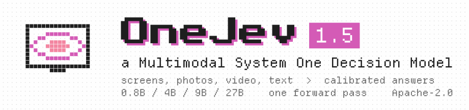
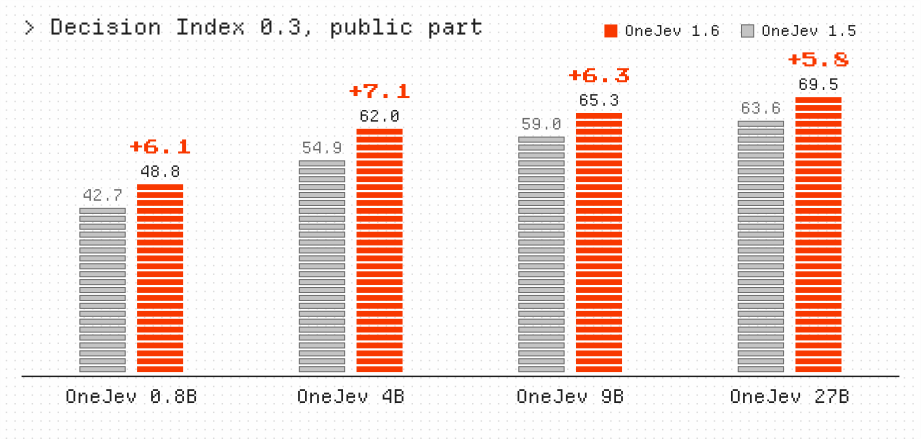
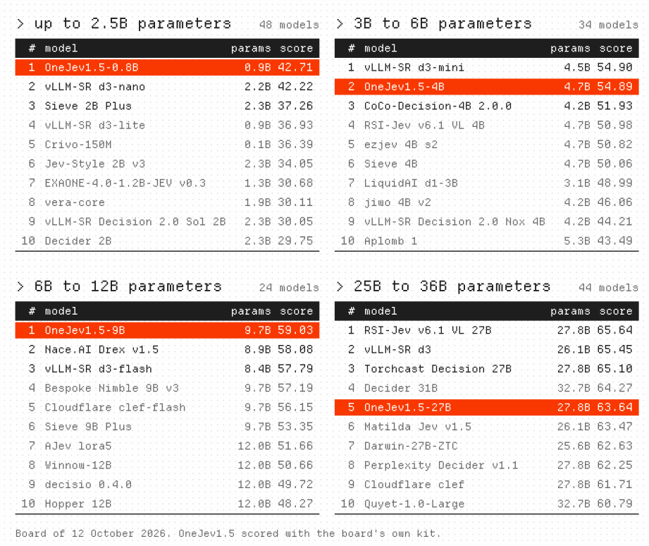
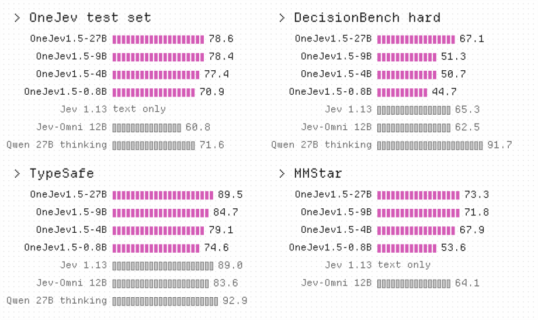
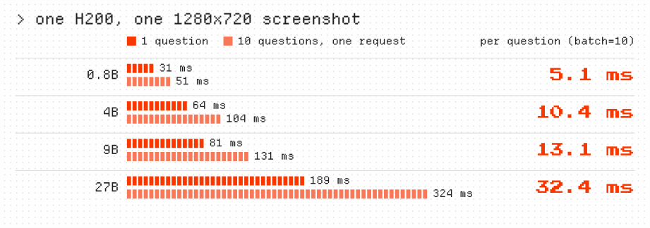
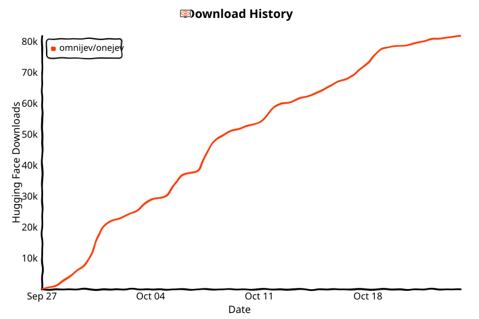

<p align="center">
  <picture>
    <source media="(prefers-color-scheme: dark)" srcset="banner-dark.svg">
    
  </picture>
</p>

<p align="center"><a href="https://github.com/OmniJev/OneJev">English</a> · <a href="README_zh.md">简体中文</a> · <a href="README_zh-Hant.md">繁體中文</a> · <a href="README_ja.md">日本語</a> · <a href="README_ko.md">한국어</a> · <b>ภาษาไทย</b> · <a href="README_tr.md">Türkçe</a></p>

<p align="center">
  <a href="https://huggingface.co/collections/OmniJev/onejev16"></a>
  <a href="https://modelscope.ai/organization/OmniJev"></a>
  <a href="https://huggingface.co/spaces/BradNLP/OneJev"></a>
  <a href="https://github.com/OmniJev/OneJev"></a>
  <a href="https://omnijev.github.io/OneJev/"></a>
</p>
<p align="center">
  <a href="https://huggingface.co/datasets/OmniJev/OneJev-Data"></a>
  <a href="../LICENSE"></a>
  <a href="https://www.python.org"></a>
  <a href="https://pytorch.org"></a>
  <a href="https://github.com/huggingface/transformers"></a>
</p>

OneJev คือโมเดลตัดสินใจแบบ System One ที่รองรับข้อมูลหลายรูปแบบ พัฒนาต่อจาก [Qwen](https://huggingface.co/Qwen) โมเดลตอบคำถามแบบมีชนิดเกี่ยวกับภาพหน้าจอ รูปถ่าย วิดีโอ และข้อความ ด้วยความน่าจะเป็นที่ผ่านการปรับเทียบแล้ว ภายใน forward pass เดียว มีให้เลือก 4 ขนาด ได้แก่ 0.8B, 4B, 9B และ 27B

## 🔥 ข่าว

- 🔥 **2026-10-17** เราเปิดตัว OneJev 1.6 บน [Hugging Face](https://huggingface.co/collections/OmniJev/onejev16) และ [ModelScope](https://modelscope.ai/organization/OmniJev) ลองใช้งานได้เลย
- **2026-10-13** เราเปิดตัว [OneJev 1.5](https://huggingface.co/collections/OmniJev/onejev15) ลองใช้งานได้เลย
- **2026-09-28** เราเปิดเดโมออนไลน์แล้ว 👉 [คลิกที่นี่](https://huggingface.co/spaces/BradNLP/OneJev)
- **2026-09-27** เราเปิดตัว [OneJev](https://huggingface.co/collections/OmniJev/onejev) และ [ชุดข้อมูล OneJev](https://huggingface.co/datasets/OmniJev/OneJev-Data)

## Decision Index (ส่วนสาธารณะ)

<p align="center">
  <picture>
    <source media="(prefers-color-scheme: dark)" srcset="progress-dark.svg">
    
  </picture>
</p>

<p align="center">
  <picture>
    <source media="(prefers-color-scheme: dark)" srcset="leaderboard-dark.svg">
    
  </picture>
</p>

## เบนช์มาร์กอื่น

<p align="center">
  <picture>
    <source media="(prefers-color-scheme: dark)" srcset="results-dark.svg">
    
  </picture>
</p>

ความแม่นยำ (%) ชุดทดสอบ OneJev เป็นชุดที่เราแยกเก็บไว้เอง ส่วนชุดอื่นเป็นเบนช์มาร์กสาธารณะ

## ความเร็ว

<p align="center">
  <picture>
    <source media="(prefers-color-scheme: dark)" srcset="speed-dark.svg">
    
  </picture>
</p>

## เริ่มต้นใช้งาน

เลือกแบ็กเอนด์หนึ่งตัวแล้วเปิดใช้งาน จากนั้นรันตัวอย่างด้านล่าง

### ตัวเลือก A: Flide

สำหรับ GPU ของ NVIDIA รองรับข้อความ รูปภาพ และวิดีโอ [Flide](https://github.com/OmniJev/Flide) คือเอนจินอนุมานสำหรับโมเดลตัดสินใจที่เราพัฒนาขึ้น

```bash
uv venv -p 3.12 && source .venv/bin/activate
uv pip install flide torchvision
flide serve --model OmniJev/OneJev1.6-0.8B --port 8000
```

### ตัวเลือก B: llama.cpp

สำหรับโมเดล GGUF รองรับข้อความและรูปภาพ ถ้าใช้วิดีโอให้ใช้ Flide ติดตั้ง [llama.cpp](https://github.com/ggml-org/llama.cpp/blob/master/docs/install.md) ก่อน (บน macOS ใช้ `brew install llama.cpp`)

```bash
pip install git+https://github.com/OmniJev/OneJev.git
qev serve --gguf mradermacher/OneJev1.6-0.8B-GGUF:Q8_0 --port 8000
```

### ตัวเลือก C: Docker

รีโปมี Compose stack ที่ตรวจจับฮาร์ดแวร์ของคุณแล้วเปิดแบ็กเอนด์ให้หนึ่งตัว โปรไฟล์ llama.cpp จะดาวน์โหลด `mradermacher/OneJev1.6-0.8B-GGUF:Q8_0` ตอนเริ่มครั้งแรก ถ้าต้องการขนาดหรือการควอนไทซ์แบบอื่น ให้ตั้งค่า `QEV_GGUF` ใน `docker/.env`

```bash
cp docker/.env.example docker/.env   # ตั้ง HF_TOKEN สำหรับรีโปที่จำกัดสิทธิ์/ส่วนตัว
./docker/start.sh                    # ตรวจจับอัตโนมัติ (Windows: .\docker\start.ps1)
./docker/start.sh logs               # ดูล็อก
./docker/start.sh down               # หยุดทุกโปรไฟล์
```

บังคับเลือกแบ็กเอนด์ได้ด้วย `./docker/start.sh <torch|rocm|vulkan|gguf|gguf-rocm|cpu>` (เพิ่ม `--build` เพื่อบิลด์ใหม่) ทุกโปรไฟล์ให้บริการ API และ Playground ที่ :8000 บน Windows ใช้ได้เฉพาะ `torch` (NVIDIA) และ `cpu`

### ส่งคำขอ

เซิร์ฟเวอร์ตอบที่ `http://localhost:8000` เปิดเทอร์มินัลอีกหน้าต่างแล้วรันตัวอย่างนี้กับไฟล์ `screenshot.png` ของคุณเอง

```bash
IMG=$(base64 -w0 screenshot.png)
curl http://localhost:8000/v1/systemone -H "Content-Type: application/json" -d @- <<EOF
{
  "state": {"task": "Pay the open invoice from ACME", "screen": "<image:1>"},
  "media": [{"type": "image", "data": "data:image/png;base64,$IMG"}],
  "questions": {
    "done": {"type": "noul", "instructions": "The invoice has been paid"},
    "next": {"type": "choice", "instructions": "What should the agent do next?",
             "criteria": {"click": "click an element", "type": "type text", "scroll": "scroll", "stop": "stop"}},
    "progress": {"type": "score", "instructions": "How far along is the task?",
                 "criteria": ["not started", "halfway", "almost done", "done"]}
  }
}
EOF
```

`answers.done.noul` คือความน่าจะเป็นที่คำตอบเป็น "ใช่" `answers.next.probabilities` ให้ความน่าจะเป็นของแต่ละตัวเลือก และ `answers.progress.score` คือระดับที่คาดหวัง

API นี้เข้ากันได้กับ TypeSafe System One ตัวอย่างเพิ่มเติม: [วิดีโอ](../examples/video.py), [curl](../examples/curl.sh), [TypeSafe SDK ทางการ](../examples/official_sdk.py)

## การเทรน

```bash
git clone https://github.com/OmniJev/OneJev.git
cd OneJev
pip install -e ".[train]"

# เลือก A หรือ B อย่างใดอย่างหนึ่ง ด้านล่างเปิดใช้ A ไว้
# A. เดโม: 100 ตัวอย่างพร้อมรูปภาพ (23 MB)
hf download OmniJev/OneJev-Data sample/sample-100.parquet --repo-type dataset --local-dir data/onejev
python -m train.unpack data/onejev --sample

# B. ชุดข้อมูลเต็ม: 94,707 ตัวอย่าง (17.7 GB) ถ้าใช้ B ให้เอาคอมเมนต์สองบรรทัดนี้ออกแทน A
# hf download OmniJev/OneJev-Data --repo-type dataset --include "data/*.parquet" --local-dir data/onejev
# python -m train.unpack data/onejev
```

ทั้งสองแบบจะสร้าง `data/onejev/train.jsonl` และแตกรูปภาพกับเฟรมวิดีโอไว้ใน `data/onejev/media/`

[OneJev-Data](https://huggingface.co/datasets/OmniJev/OneJev-Data) เผยแพร่คำถามสำหรับเทรน 94,707 ข้อ จากทั้งหมด 99,193 ข้อ แหล่งข้อมูลที่เหลือไม่อนุญาตให้เผยแพร่ต่อ

### ไฟน์จูน

โมเดลทั้งสี่ไฟน์จูนจาก Qwen3.5-0.8B, Qwen3.5-4B, Qwen3.5-9B และ Qwen3.8-27B เป็นเวลาหนึ่ง epoch โดยตรึง vision tower ไว้ คอนฟิกใช้ learning rate `5e-6` จำกัดความยาว 16,384 โทเค็น และใช้ cross-entropy ร่วมกับ Brier loss บนความน่าจะเป็นของคำตอบ หากต้องการเทรนโมเดล 4B บน GPU สี่ตัว:

```bash
torchrun --nproc-per-node 4 -m train.sft --config train/configs/onejev_4b_full.yaml
```

คอนฟิก: [0.8B](../train/configs/onejev_08b_full.yaml) · [4B](../train/configs/onejev_4b_full.yaml) · [9B](../train/configs/onejev_9b_full.yaml) · [27B](../train/configs/onejev_27b_full.yaml) ตั้ง `--nproc-per-node` ให้เท่ากับจำนวน GPU คอนฟิก 9B และ 27B เปิดใช้ FSDP เพื่อแบ่งสถานะของโมเดลและ optimizer ถ้าใช้ข้อมูลของคุณเอง ให้แก้ `train` และ `media_root` ในคอนฟิก

เช็กพอยต์สุดท้ายของ 4B จะถูกบันทึกไว้ที่ `train/runs/onejev_4b/final` เปิดใช้งานด้วยคำสั่ง:

```bash
flide serve --model train/runs/onejev_4b/final --format onejev --port 8000
```

## Friendly Links

- [LINUX DO](https://linux.do)
- [Jev](https://typesafe.ai)
- [Awesome JEV](https://github.com/OmniJev/awesome-jev-gallery)
- [Awesome JEV Website](https://omnijev.github.io/awesome-jev-gallery/)
- [PlayJev](https://github.com/OmniJev/PlayJev)

## สัญญาอนุญาต

[Apache 2.0](../LICENSE)

## ดาวและยอดดาวน์โหลด

<p>
  <a href="https://star-history.com/#OmniJev/OneJev&Date"></a>
  <a href="https://huggingface.co/OmniJev"></a>
</p>

## การอ้างอิง

```bibtex
@misc{onejev2026,
  title        = {{OneJev}: A Multimodal System One Decision Model},
  author       = {{OmniJev Team}},
  year         = {2026},
  howpublished = {\url{https://github.com/OmniJev/OneJev}}
}
```
