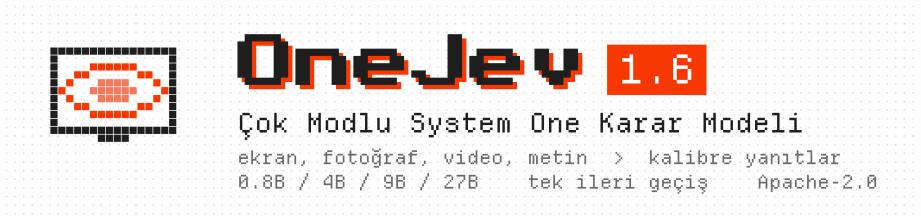
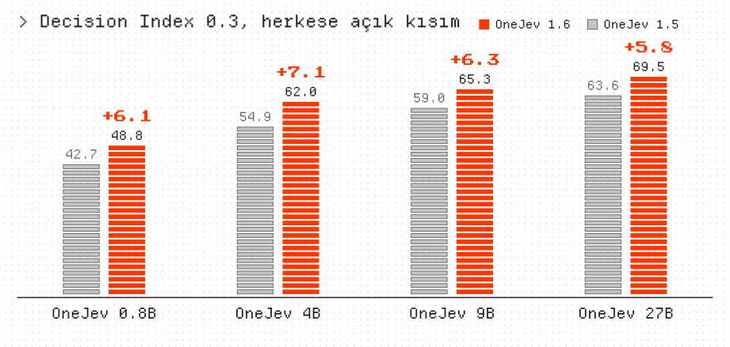
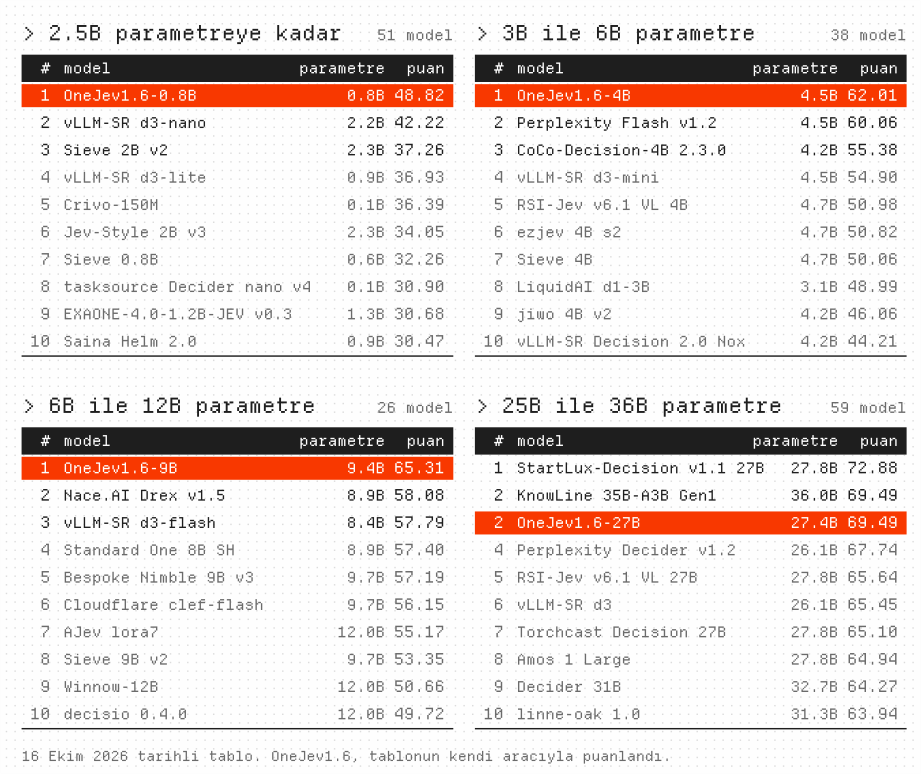
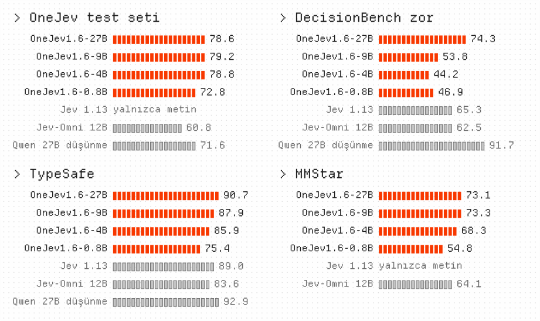
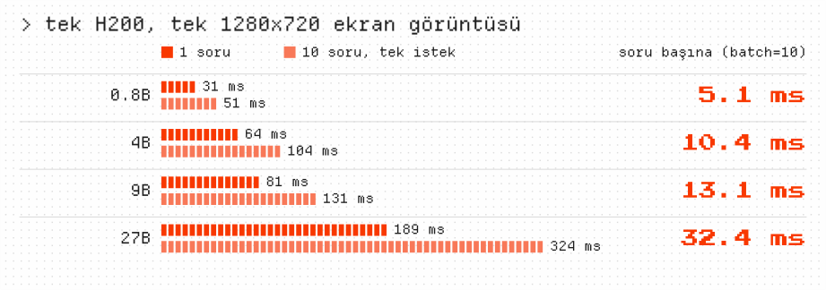

<p align="center">
  <picture>
    <source media="(prefers-color-scheme: dark)" srcset="tr/banner-dark.svg">
    
  </picture>
</p>

<p align="center"><a href="https://github.com/OmniJev/OneJev">English</a> · <a href="README_zh.md">简体中文</a> · <a href="README_zh-Hant.md">繁體中文</a> · <a href="README_ja.md">日本語</a> · <a href="README_ko.md">한국어</a> · <a href="README_th.md">ภาษาไทย</a> · <b>Türkçe</b></p>

<p align="center">
  <a href="https://huggingface.co/collections/OmniJev/onejev16"></a>
  <a href="https://modelscope.ai/organization/OmniJev"></a>
  <a href="https://huggingface.co/spaces/BradNLP/OneJev"></a>
  <a href="https://github.com/OmniJev/OneJev"></a>
  <a href="https://omnijev.github.io/OneJev/"></a>
</p>
<p align="center">
  <a href="https://huggingface.co/datasets/OmniJev/OneJev-Data"></a>
  <a href="../LICENSE"></a>
  <a href="https://www.python.org"></a>
  <a href="https://pytorch.org"></a>
  <a href="https://github.com/huggingface/transformers"></a>
</p>

OneJev, [Qwen](https://huggingface.co/Qwen) tabanlı çok modlu bir System One karar modelidir. Ekran görüntüleri, fotoğraflar, videolar ve metinler hakkındaki tipli sorulara tek bir ileri geçişte kalibre edilmiş olasılıklar döndürür. 0.8B, 4B, 9B ve 27B boyutlarında sunulur.

## 🔥 Haberler

- 🔥 **2026-10-17** OneJev 1.6'yı [Hugging Face](https://huggingface.co/collections/OmniJev/onejev16) ve [ModelScope](https://modelscope.ai/organization/OmniJev) üzerinde yayınladık. Denemenizi bekliyoruz.
- **2026-10-13** [OneJev 1.5](https://huggingface.co/collections/OmniJev/onejev15)'i yayınladık. Denemenizi bekliyoruz.
- **2026-09-28** Çevrimiçi demoyu yayınladık, 👉 [Buraya tıklayın](https://huggingface.co/spaces/BradNLP/OneJev).
- **2026-09-27** [OneJev](https://huggingface.co/collections/OmniJev/onejev)'i ve [OneJev veri setini](https://huggingface.co/datasets/OmniJev/OneJev-Data) yayınladık.

## Decision Index (herkese açık kısım)

<p align="center">
  <picture>
    <source media="(prefers-color-scheme: dark)" srcset="tr/progress-dark.svg">
    
  </picture>
</p>

<p align="center">
  <picture>
    <source media="(prefers-color-scheme: dark)" srcset="tr/leaderboard-dark.svg">
    
  </picture>
</p>

## Diğer karşılaştırmalar

<p align="center">
  <picture>
    <source media="(prefers-color-scheme: dark)" srcset="tr/results-dark.svg">
    
  </picture>
</p>

Doğruluk (%). OneJev test seti eğitimde kullanılmayan kendi değerlendirme setimizdir; diğerleri herkese açıktır.

## Hız

<p align="center">
  <picture>
    <source media="(prefers-color-scheme: dark)" srcset="tr/speed-dark.svg">
    
  </picture>
</p>

## Hızlı başlangıç

Bir arka uç seçip başlatın, ardından aşağıdaki örneği çalıştırın.

### Seçenek A: Flide

NVIDIA GPU'lar içindir. Metin, görsel ve video destekler. [Flide](https://github.com/OmniJev/Flide), karar modelleri için geliştirdiğimiz çıkarım motorudur.

```bash
uv venv -p 3.12 && source .venv/bin/activate
uv pip install flide torchvision
flide serve --model OmniJev/OneJev1.6-0.8B --port 8000
```

### Seçenek B: llama.cpp

GGUF modelleri içindir. Metin ve görsel destekler; video için Flide kullanın. Önce [llama.cpp](https://github.com/ggml-org/llama.cpp/blob/master/docs/install.md)'yi kurun (macOS'ta `brew install llama.cpp`).

```bash
pip install git+https://github.com/OmniJev/OneJev.git
qev serve --gguf mradermacher/OneJev1.6-0.8B-GGUF:Q8_0 --port 8000
```

### Seçenek C: Docker

Depoda, donanımınızı algılayıp tek bir arka uç başlatan bir Compose yığını bulunur. llama.cpp profilleri ilk açılışta `mradermacher/OneJev1.6-0.8B-GGUF:Q8_0` dosyasını indirir; başka bir boyut ya da nicemleme için `docker/.env` içinde `QEV_GGUF` değerini ayarlayın.

```bash
cp docker/.env.example docker/.env   # erişimi kısıtlı/özel depolar için HF_TOKEN ayarlayın
./docker/start.sh                    # otomatik algılama (Windows: .\docker\start.ps1)
./docker/start.sh logs               # günlükleri izle
./docker/start.sh down               # tüm profilleri durdur
```

Arka ucu `./docker/start.sh <torch|rocm|vulkan|gguf|gguf-rocm|cpu>` ile zorlayabilirsiniz (yeniden derlemek için `--build` ekleyin). Her profil API'yi ve Playground'u :8000 üzerinde sunar. Windows'ta yalnızca `torch` (NVIDIA) ve `cpu` kullanılabilir.

### İstek gönderme

Sunucu `http://localhost:8000` adresinden yanıt verir. Başka bir terminalde, kendi `screenshot.png` dosyanızla bu örneği çalıştırın:

```bash
IMG=$(base64 -w0 screenshot.png)
curl http://localhost:8000/v1/systemone -H "Content-Type: application/json" -d @- <<EOF
{
  "state": {"task": "Pay the open invoice from ACME", "screen": "<image:1>"},
  "media": [{"type": "image", "data": "data:image/png;base64,$IMG"}],
  "questions": {
    "done": {"type": "noul", "instructions": "The invoice has been paid"},
    "next": {"type": "choice", "instructions": "What should the agent do next?",
             "criteria": {"click": "click an element", "type": "type text", "scroll": "scroll", "stop": "stop"}},
    "progress": {"type": "score", "instructions": "How far along is the task?",
                 "criteria": ["not started", "halfway", "almost done", "done"]}
  }
}
EOF
```

`answers.done.noul` "evet" olasılığıdır, `answers.next.probabilities` her seçenek için bir olasılık verir ve `answers.progress.score` beklenen düzeydir.

API, TypeSafe System One ile uyumludur. Daha fazla örnek: [video](../examples/video.py), [curl](../examples/curl.sh), [resmi TypeSafe SDK](../examples/official_sdk.py).

## Eğitim

```bash
git clone https://github.com/OmniJev/OneJev.git
cd OneJev
pip install -e ".[train]"

# A veya B'yi seçin. Aşağıda A etkin.
# A. Demo: görselli 100 örnek (23 MB)
hf download OmniJev/OneJev-Data sample/sample-100.parquet --repo-type dataset --local-dir data/onejev
python -m train.unpack data/onejev --sample

# B. Tam veri seti: 94,707 örnek (17.7 GB). A yerine bu iki satırın yorumunu kaldırın.
# hf download OmniJev/OneJev-Data --repo-type dataset --include "data/*.parquet" --local-dir data/onejev
# python -m train.unpack data/onejev
```

İki seçenek de `data/onejev/train.jsonl` dosyasını oluşturur ve görselleri ile video karelerini `data/onejev/media/` altına çıkarır.

[OneJev-Data](https://huggingface.co/datasets/OmniJev/OneJev-Data), özgün 99,193 eğitim sorusunun 94,707'sini yayınlar; kalan kaynaklar yeniden dağıtıma izin vermez.

### İnce ayar

Dört model; Qwen3.5-0.8B, Qwen3.5-4B, Qwen3.5-9B ve Qwen3.8-27B'nin görsel kulesi dondurularak bir epoch boyunca ince ayarlanmasıyla elde edilir. Yapılandırmalar `5e-6` öğrenme oranı, 16,384 token sınırı ve yanıt olasılıkları üzerinde çapraz entropi ile Brier kaybı kullanır. 4B modeli dört GPU'da eğitmek için:

```bash
torchrun --nproc-per-node 4 -m train.sft --config train/configs/onejev_4b_full.yaml
```

Yapılandırmalar: [0.8B](../train/configs/onejev_08b_full.yaml) · [4B](../train/configs/onejev_4b_full.yaml) · [9B](../train/configs/onejev_9b_full.yaml) · [27B](../train/configs/onejev_27b_full.yaml). `--nproc-per-node` değerini GPU sayınıza göre ayarlayın; 9B ve 27B yapılandırmaları model ve optimizer durumunu bölmek için FSDP'yi etkinleştirir. Kendi verileriniz için yapılandırmadaki `train` ve `media_root` alanlarını değiştirin.

Son 4B checkpoint'i `train/runs/onejev_4b/final` konumuna kaydedilir. Şu komutla başlatın:

```bash
flide serve --model train/runs/onejev_4b/final --format onejev --port 8000
```

## Friendly Links

- [LINUX DO](https://linux.do)
- [Jev](https://typesafe.ai)
- [Awesome JEV](https://github.com/OmniJev/awesome-jev-gallery)
- [Awesome JEV Website](https://omnijev.github.io/awesome-jev-gallery/)
- [PlayJev](https://github.com/OmniJev/PlayJev)

## Lisans

[Apache 2.0](../LICENSE)

## Yıldızlar ve indirmeler

<p>
  <a href="https://star-history.com/#OmniJev/OneJev&Date"></a>
  <a href="https://huggingface.co/OmniJev"></a>
</p>

## Atıf

```bibtex
@misc{onejev2026,
  title        = {{OneJev}: A Multimodal System One Decision Model},
  author       = {{OmniJev Team}},
  year         = {2026},
  howpublished = {\url{https://github.com/OmniJev/OneJev}}
}
```
