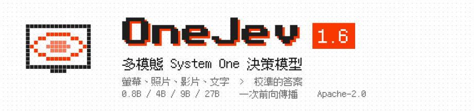
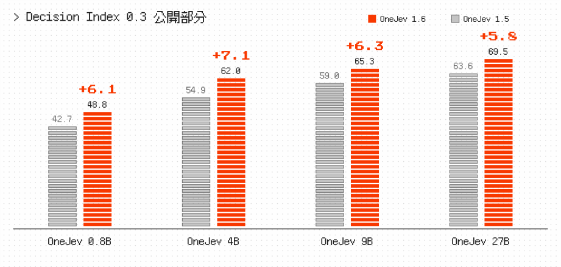
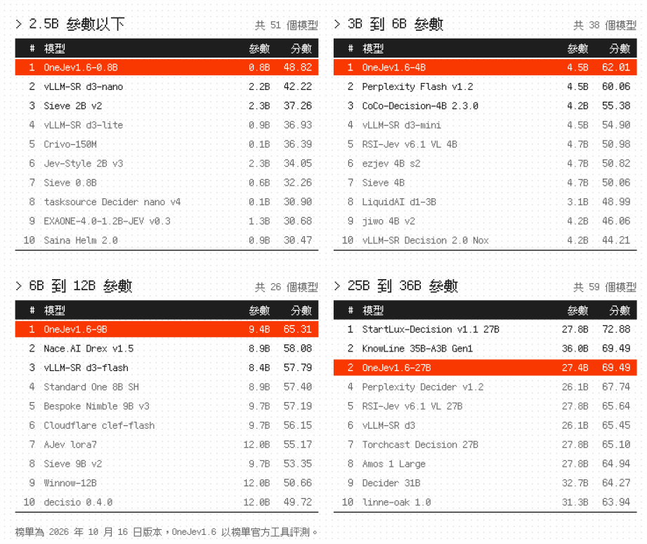
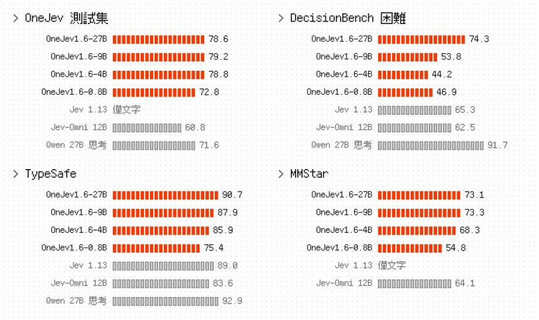
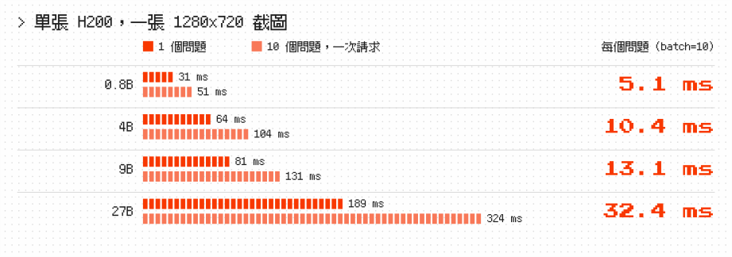

<p align="center">
  <picture>
    <source media="(prefers-color-scheme: dark)" srcset="zh-Hant/banner-dark.svg">
    
  </picture>
</p>

<p align="center"><a href="https://github.com/OmniJev/OneJev">English</a> · <a href="README_zh.md">简体中文</a> · <b>繁體中文</b> · <a href="README_ja.md">日本語</a> · <a href="README_ko.md">한국어</a> · <a href="README_th.md">ภาษาไทย</a> · <a href="README_tr.md">Türkçe</a></p>

<p align="center">
  <a href="https://huggingface.co/collections/OmniJev/onejev16"></a>
  <a href="https://modelscope.ai/organization/OmniJev"></a>
  <a href="https://huggingface.co/spaces/BradNLP/OneJev"></a>
  <a href="https://github.com/OmniJev/OneJev"></a>
  <a href="https://omnijev.github.io/OneJev/"></a>
</p>
<p align="center">
  <a href="https://huggingface.co/datasets/OmniJev/OneJev-Data"></a>
  <a href="../LICENSE"></a>
  <a href="https://www.python.org"></a>
  <a href="https://pytorch.org"></a>
  <a href="https://github.com/huggingface/transformers"></a>
</p>

OneJev 是基於 [Qwen](https://huggingface.co/Qwen) 的多模態 System One 決策模型，一次前向傳播即可為截圖、照片、影片和文字上的帶型別問題回傳校準後的機率，提供 0.8B、4B、9B 和 27B 四種尺寸。

## 🔥 最新消息

- 🔥 **2026-10-17** 我們在 [Hugging Face](https://huggingface.co/collections/OmniJev/onejev16) 和 [ModelScope](https://modelscope.ai/organization/OmniJev) 發布了 OneJev 1.6，歡迎試用。
- **2026-10-13** 我們發布了 [OneJev 1.5](https://huggingface.co/collections/OmniJev/onejev15)，歡迎試用。
- **2026-09-28** 我們上線了線上 demo，👉 [點我試用](https://huggingface.co/spaces/BradNLP/OneJev)。
- **2026-09-27** 我們發布了 [OneJev](https://huggingface.co/collections/OmniJev/onejev) 和 [OneJev 資料集](https://huggingface.co/datasets/OmniJev/OneJev-Data)。

## Decision Index（公開部分）

<p align="center">
  <picture>
    <source media="(prefers-color-scheme: dark)" srcset="zh-Hant/progress-dark.svg">
    
  </picture>
</p>

<p align="center">
  <picture>
    <source media="(prefers-color-scheme: dark)" srcset="zh-Hant/leaderboard-dark.svg">
    
  </picture>
</p>

## 其他評測

<p align="center">
  <picture>
    <source media="(prefers-color-scheme: dark)" srcset="zh-Hant/results-dark.svg">
    
  </picture>
</p>

準確率（%）。OneJev 測試集是我們自己的保留集，其餘為公開評測。

## 速度

<p align="center">
  <picture>
    <source media="(prefers-color-scheme: dark)" srcset="zh-Hant/speed-dark.svg">
    
  </picture>
</p>

## 快速開始

任選一種後端啟動，再執行下面的 Python 範例。

### 選項 A：Flide

適用於 NVIDIA GPU，支援文字、圖片和影片。[Flide](https://github.com/OmniJev/Flide) 是我們的決策模型推論引擎。

```bash
uv venv -p 3.12 && source .venv/bin/activate
uv pip install flide torchvision
flide serve --model OmniJev/OneJev1.6-0.8B --port 8000
```

### 選項 B：llama.cpp

使用 GGUF 模型，支援文字和圖片；影片請使用 Flide。先安裝 [llama.cpp](https://github.com/ggml-org/llama.cpp/blob/master/docs/install.md)（macOS 可執行 `brew install llama.cpp`）。

```bash
pip install git+https://github.com/OmniJev/OneJev.git
qev serve --gguf mradermacher/OneJev1.6-0.8B-GGUF:Q8_0 --port 8000
```

### 選項 C：Docker

儲存庫附帶 Compose 堆疊，會自動偵測硬體並啟動一種後端。llama.cpp 設定第一次啟動時會下載 `mradermacher/OneJev1.6-0.8B-GGUF:Q8_0`；要換尺寸或量化，請在 `docker/.env` 中設定 `QEV_GGUF`。

```bash
cp docker/.env.example docker/.env   # 受限/私有儲存庫請設定 HF_TOKEN
./docker/start.sh                    # 自動偵測（Windows：.\docker\start.ps1）
./docker/start.sh logs               # 追蹤日誌
./docker/start.sh down               # 停止所有 profile
```

用 `./docker/start.sh <torch|rocm|vulkan|gguf|gguf-rocm|cpu>` 強制指定後端（加 `--build` 重新建置）。所有設定都在 :8000 提供 API 和 Playground 介面。Windows 上僅支援 `torch`（NVIDIA）和 `cpu`。

### 發送請求

服務位址是 `http://localhost:8000`。在另一個終端機中，用你自己的 `screenshot.png` 執行範例：

```bash
IMG=$(base64 -w0 screenshot.png)
curl http://localhost:8000/v1/systemone -H "Content-Type: application/json" -d @- <<EOF
{
  "state": {"任務": "支付 ACME 的待付款發票", "螢幕": "<image:1>"},
  "media": [{"type": "image", "data": "data:image/png;base64,$IMG"}],
  "questions": {
    "完成狀態": {"type": "noul", "instructions": "發票已付款"},
    "下一步": {"type": "choice", "instructions": "代理下一步應該做什麼？",
              "criteria": {"點擊": "點擊介面元素", "輸入": "輸入文字", "捲動": "捲動頁面", "停止": "停止操作"}},
    "任務進度": {"type": "score", "instructions": "任務完成到哪一步了？",
                "criteria": ["尚未開始", "完成一半", "即將完成", "已完成"]}
  }
}
EOF
```

`answers.完成狀態.noul` 是「是」的機率，`answers.下一步.probabilities` 給出每個選項的機率，`answers.任務進度.score` 是期望等級。

API 相容 TypeSafe System One。更多範例：[影片](../examples/video.py)、[curl](../examples/curl.sh)、[官方 TypeSafe SDK](../examples/official_sdk.py)。

## 訓練

```bash
git clone https://github.com/OmniJev/OneJev.git
cd OneJev
pip install -e ".[train]"

# A、B 二選一，下面預設啟用 A。
# A. Demo：100 筆樣本，含圖片（23 MB）
hf download OmniJev/OneJev-Data sample/sample-100.parquet --repo-type dataset --local-dir data/onejev
python -m train.unpack data/onejev --sample

# B. 完整資料：94,707 筆（17.7 GB）。使用 B 時，取消下面兩行的註解，並跳過 A。
# hf download OmniJev/OneJev-Data --repo-type dataset --include "data/*.parquet" --local-dir data/onejev
# python -m train.unpack data/onejev
```

兩種方式都會產生 `data/onejev/train.jsonl`，並將圖片和影片影格解壓到 `data/onejev/media/`。

[OneJev-Data](https://huggingface.co/datasets/OmniJev/OneJev-Data) 公開了原始 99,193 道訓練題中的 94,707 道，其餘來源不允許再散布。

### 微調

四個模型分別基於 Qwen3.5-0.8B、Qwen3.5-4B、Qwen3.5-9B 和 Qwen3.8-27B，凍結視覺塔，微調一輪。設定使用 `5e-6` 學習率、16,384 token 長度上限，對答案機率計算交叉熵和 Brier 損失。在四張 GPU 上訓練 4B 模型：

```bash
torchrun --nproc-per-node 4 -m train.sft --config train/configs/onejev_4b_full.yaml
```

設定：[0.8B](../train/configs/onejev_08b_full.yaml) · [4B](../train/configs/onejev_4b_full.yaml) · [9B](../train/configs/onejev_9b_full.yaml) · [27B](../train/configs/onejev_27b_full.yaml)。將 `--nproc-per-node` 設為 GPU 數量；9B 和 27B 設定啟用 FSDP，分片儲存模型與最佳化器狀態。使用自己的資料時，修改設定中的 `train` 和 `media_root`。

4B 的最終模型儲存在 `train/runs/onejev_4b/final`，可直接啟動：

```bash
flide serve --model train/runs/onejev_4b/final --format onejev --port 8000
```

## Friendly Links

- [LINUX DO](https://linux.do)
- [Jev](https://typesafe.ai)
- [Awesome JEV](https://github.com/OmniJev/awesome-jev-gallery)
- [Awesome JEV Website](https://omnijev.github.io/awesome-jev-gallery/)
- [PlayJev](https://github.com/OmniJev/PlayJev)

## 授權條款

[Apache 2.0](../LICENSE)

## 星標與下載量

<p>
  <a href="https://star-history.com/#OmniJev/OneJev&Date"></a>
  <a href="https://huggingface.co/OmniJev"></a>
</p>

## 引用

```bibtex
@misc{onejev2026,
  title        = {{OneJev}: A Multimodal System One Decision Model},
  author       = {{OmniJev Team}},
  year         = {2026},
  howpublished = {\url{https://github.com/OmniJev/OneJev}}
}
```
